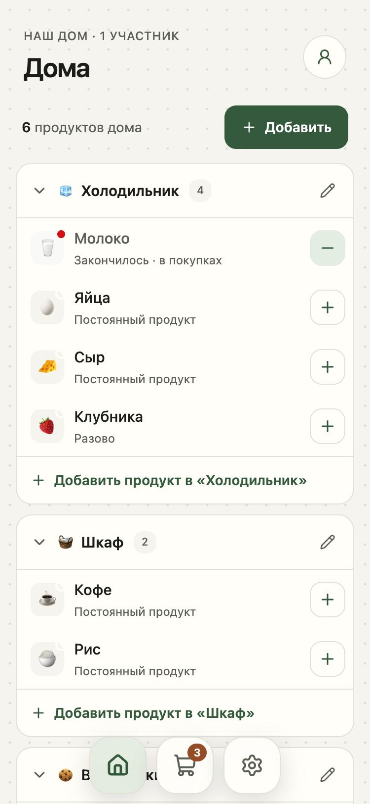
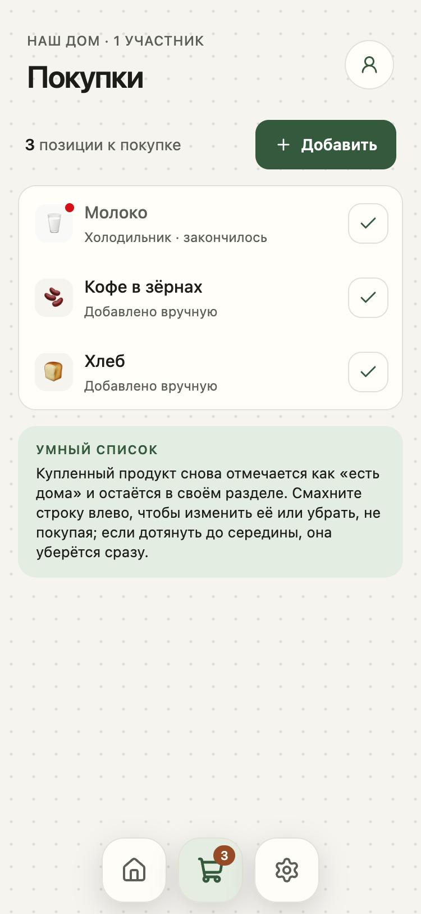
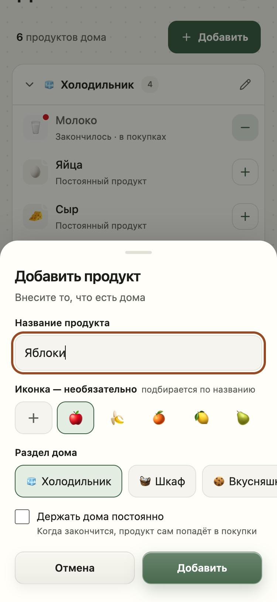
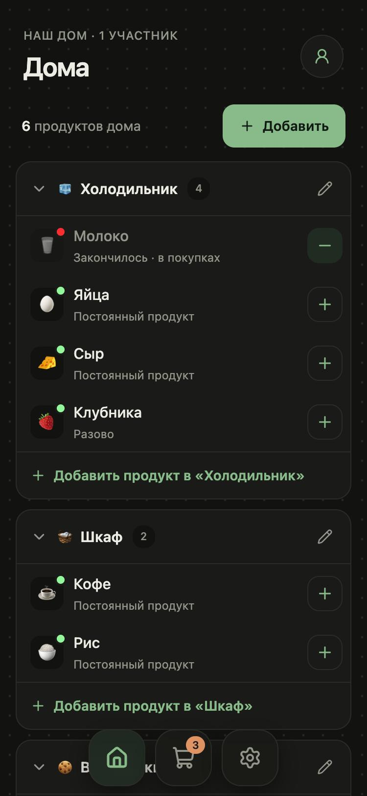

# food-stock

A shared home pantry and shopping list, as a PWA for phones. In Russian, English, Japanese
and Vietnamese. [По-русски](README.ru.md)

Every product has two independent marks: whether it's at home (a dot on the icon) and
whether it's on the shopping list (the "+ / −" button). A product that runs out goes to
the shopping list by itself and comes back to its section once bought. Sections are
your own — "Fridge", "Pantry", "Snacks". Several people share one home and see each
other's changes live.

<p>
  
  
  
  
</p>

What's in it:

- no sign-up: a home is created on first launch, other people join with a one-time link;
  Google sign-in is optional and merges the device's data into the account;
- drag and drop for products, sections and the shopping list, with keyboard and screen
  reader support;
- swipe for edit and delete, delete with "Undo", one name — one thing across home and
  shopping;
- a sheet that stays above the iPhone keyboard (more in [iPhone notes](docs/en/ios-notes.md));
- light and dark themes, six accent colors, four languages;
- an install guide for every device, with a choice of seven app icons before installing; old versions keep working against the same
  database while a new one rolls out.

Stack: React 19 + TypeScript + Vite, React Router, TanStack Query, Supabase
(Postgres + Auth + Realtime), dnd-kit, `vite-plugin-pwa`. Structure — Feature-Sliced
Design.

## Run

```bash
npm install
npm run dev
```

Without any settings the app starts in **demo mode**: data lives in the browser's
`localStorage`, tabs of the same browser sync with each other. Enough to try every flow.

| Command | What it does |
| --- | --- |
| `npm run dev` | dev server |
| `npm test` | tests: MVP acceptance criteria on the local storage, migrations and RLS on embedded Postgres |
| `npm run build` | type check and build into `dist/` (with manifest and service worker) |
| `npm run preview` | serve the build locally — this is where PWA install can be checked |
| `npm run lint` | oxlint |

## Connect Supabase

1. Create a project on supabase.com.
2. Apply the migrations from `supabase/migrations/` in order — in the SQL Editor or with
   `supabase db push`.
3. Authentication → Sign In / Providers → turn on **Allow anonymous sign-ins**.
4. Copy `.env.example` to `.env.local` and fill in `VITE_SUPABASE_URL` and
   `VITE_SUPABASE_ANON_KEY` (the public key only, never the service-role one).

No email setup is needed: there's no sign-up. A user and a home are created on first
launch, other people join with a one-time link.

### Google sign-in (optional)

Until the Google provider is enabled in Supabase, the app behaves as if it didn't exist.

1. [Google Cloud Console](https://console.cloud.google.com/) → **APIs & Services →
   OAuth consent screen**: External, app name and support email, then **Publish app**.
2. **Credentials → Create credentials → OAuth client ID**, Web application. Authorized
   redirect URI: `https://<project>.supabase.co/auth/v1/callback`.
3. Supabase → Authentication → Sign In / Providers → **Google**: enable, paste the
   Client ID and secret.
4. Supabase → Authentication → URL Configuration: **Site URL** is the app address; add
   `http://localhost:5173/**` to **Redirect URLs** for development.

How the merge with a device's anonymous user works is in
[decision 0005](docs/en/decisions/0005-google-account-merge.md).

## Updates

A deploy replaces only the app files; data stays in Supabase. For a while the old and the
new version work with the same database, so migrations only add, and there's no lazy
loading. The rules are in [decision 0004](docs/en/decisions/0004-safe-updates.md).

## How it's built

```
src/
  app/        startup, routes, providers (auth, merge, household gates), layout, SheetHost
  pages/      home, shopping, settings, sections, welcome (with the install guide), merge choice
  widgets/    header, tab bar
  features/   forms in sheets: product, shopping item, purchase, section, home, name,
              join, invite; account actions
  entities/   product, section, shopping item, shopping list, member, invite, home:
              queries and mutations, rules, small UI
  shared/     api (storage contract, local and Supabase backends, cache), i18n,
              lib (small standalone modules), ui (shared elements, sheets)
supabase/
  migrations/ schema, RLS policies, RPC
  tests/      migrations + RLS checked on PGlite
```

Layers follow Feature-Sliced Design: a layer imports only the layers below it, slices of
one layer don't know each other, from outside a slice is reached only through its
`index.ts` ([decision 0011](docs/en/decisions/0011-feature-sliced-design.md)). A test
checks it.

More in [docs/en](docs/en): the [product brief](docs/en/product-brief.md),
[decisions](docs/en/decisions), [release notes](docs/en/releases), a
[dev diary](docs/en/diary.md) and [iPhone notes](docs/en/ios-notes.md) — what Safari
and the Home Screen app do to sheets and the keyboard. How to make changes is in
[CONTRIBUTING](CONTRIBUTING.md).

## License

[MIT](LICENSE)
